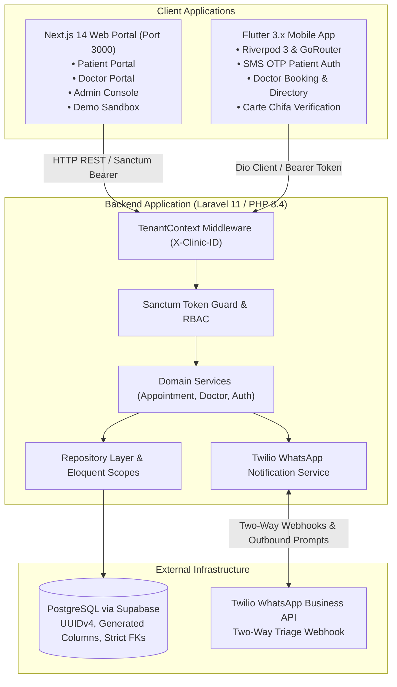
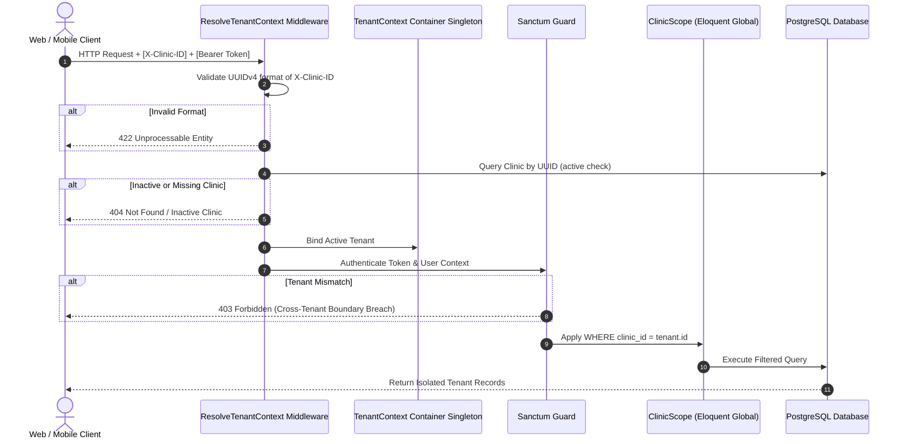
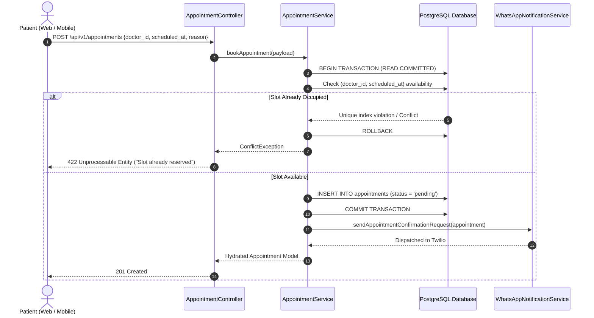
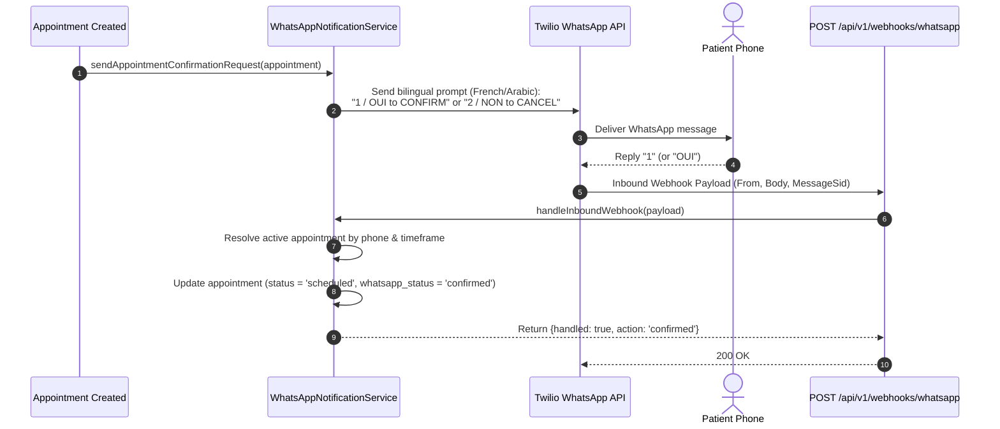
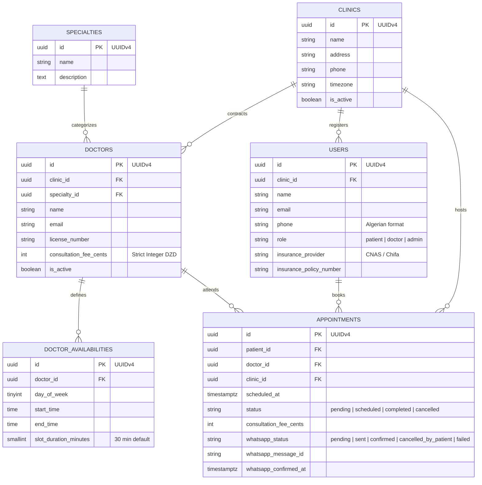

# VitalBook: Full-Stack System Architecture & Engineering Specifications

> **Status:** Production Architecture Blueprint (MVP Verified)  
> **Audience:** Principal Architects, Full-Stack Engineers, Security & DevOps Leads  
> **Stack:** Next.js 14.2 (App Router) · Flutter 3.x (Mobile) · Laravel 11 (REST API) · PostgreSQL (Supabase) · Twilio WhatsApp Gateway

---

## 1. Architectural Foundations & Invariants

VitalBook enforces four non-negotiable computer science foundations across web, mobile, and backend tiers:

1. **Deterministic Financial Arithmetic (Zero IEEE 754 Drift):**
   Standard floating-point representation (`FLOAT` / `DOUBLE`) introduces silent rounding errors. In healthcare billing, all consultation fees and balances are strictly stored and computed as integer centimes (`int consultation_fee_cents` in Algerian Dinars DZD). Presentation layers format currency strictly at the display boundary.
2. **Deterministic Multi-Tenant Scoping:**
   Clinic tenant isolation is enforced at the persistence layer using Eloquent Global Scopes. Middleware validates the `X-Clinic-ID` UUID header against the authenticated user's assigned tenant, completely preventing cross-tenant medical record leaks.
3. **Universally Unique Entity Identity (UUIDv4):**
   Auto-incrementing serial IDs (`BIGSERIAL`) introduce enumeration vulnerabilities and sharding bottlenecks. All core entities (`clinics`, `doctors`, `patients`, `appointments`) utilize pseudorandom UUIDv4 identifiers.
4. **Strict Concurrency Control (Anti-Double-Booking):**
   Consultation slots represent shared finite inventory. VitalBook prevents double-booking via database transactions combined with a composite unique database index: `(doctor_id, scheduled_at)`.

---

## 2. Decoupled Monorepo Topography

The platform is architected as an encapsulated multi-client ecosystem sharing a centralized Laravel 11 REST API:



---

## 3. Multi-Tenant Request Isolation Flow

Every API transaction resolves and locks tenant context before executing queries:



---

## 4. Anti-Double-Booking Concurrency State Machine



---

## 5. Automated Two-Way WhatsApp Triage Engine

VitalBook incorporates an interactive WhatsApp booking confirmation and triage system:



---

## 6. Cross-Platform Mobile Client Architecture (Flutter)

The Flutter application (`apps/mobile`) adheres to Feature-Driven Clean Architecture:

- **State Management:** Riverpod 3 with code-generation (`@riverpod`, `AsyncNotifier`, `Notifier`).
- **Routing:** Declarative `GoRouter` with auth guard redirection (`/login`, `/home`, `/doctors`, `/booking`).
- **HTTP Transport:** Dio client configured with authentication interceptors and token refreshing.
- **Algerian Localization:** Validation rules for 10-digit Algerian phone numbers (`05/06/07`), Wilaya selector (58 Wilayas), and Carte Chifa insurance validation.

```
apps/mobile/lib/
├── core/
│   ├── network/          # Dio client, API interceptors
│   ├── router/           # GoRouter route declarations & guards
│   ├── theme/            # VitalSoft brand design tokens
│   └── widgets/          # Shared atomic widgets & brand logos
└── features/
    ├── auth/             # OTP authentication, Login, Register, StateNotifiers
    ├── doctors/          # Specialties, Doctor listings, Profile reviews
    └── appointments/     # Dynamic slot selection, Booking flow, My Appointments
```

---

## 7. Role-Based Access Control (RBAC) Matrix

| Domain Endpoint | Patient Portal | Doctor Workspace | Clinic Admin | Unauthenticated |
| :--- | :---: | :---: | :---: | :---: |
| `POST /api/v1/auth/login` | ✅ | ❌ | ❌ | ✅ |
| `POST /api/v1/appointments` | ✅ (Own) | ❌ | ✅ (All) | ❌ |
| `GET /api/v1/doctor-portal/schedule` | ❌ | ✅ (Assigned) | ✅ (All) | ❌ |
| `PUT /api/v1/doctor-portal/appointments/{id}/status` | ❌ | ✅ | ✅ | ❌ |
| `GET /api/v1/admin/dashboard` | ❌ | ❌ | ✅ | ❌ |
| `POST /api/v1/admin/appointments/{id}/ping-whatsapp` | ❌ | ❌ | ✅ | ❌ |

---

## 8. Database Entity Relationship Model (UUIDv4)



---

## 7. Asynchronous Queue Architecture & Notifications Engine

Outbound patient communications (WhatsApp interactive prompts and SMS fallback alerts) are decoupled from the HTTP request-response lifecycle using a Redis-backed queue system managed by Supervisor:

```mermaid
flowchart LR
    Booking["AppointmentService<br/>bookAppointment()"] -->|Dispatch Job| RedisQueue[("Redis Queue<br/>queue: notifications")]
    RedisQueue --> Worker["Supervisor Queue Worker<br/>queue:work redis --queue=notifications,default"]
    Worker -->|Execute| WAGateway["WhatsAppNotificationService<br/>SendWhatsAppAppointmentReminderJob"]
    Worker -->|Execute| SMSGateway["SmsNotificationService<br/>SendSmsNotificationJob"]
    WAGateway --> TwilioWA["Twilio WhatsApp API"]
    SMSGateway --> TwilioSMS["Twilio SMS API"]
    Worker -.->|Retries [10s, 30s, 90s]| RedisQueue
    Worker -.->|3x Exhausted| FailedHook["failed() Hook<br/>Mark status: failed"]
```

### Queue Operational Invariants
1. **Dedicated Queue Segregation:** Notification workloads run on the isolated `notifications` queue to prevent background notifications from blocking mission-critical transactions.
2. **Exponential Backoff:** Jobs implement progressive delay intervals (`[10, 30, 90]` seconds) across 3 attempts to absorb transient upstream telecom gateway rate limits or downtime.
3. **Graceful Failure Propagation:** Upon exhausting all 3 retries, the `failed(?\Throwable $exception)` lifecycle hook updates the appointment `whatsapp_status` to `failed` and writes telemetry to Laravel error logs without unhandled crashes.
4. **Abstracted Gateway Drivers:** Both `IWhatsAppGateway` and `ISmsGateway` support hot-swappable implementations via service provider bindings (`TwilioWhatsAppGateway` / `LogWhatsAppGateway` and `TwilioSmsGateway` / `LogSmsGateway`).

