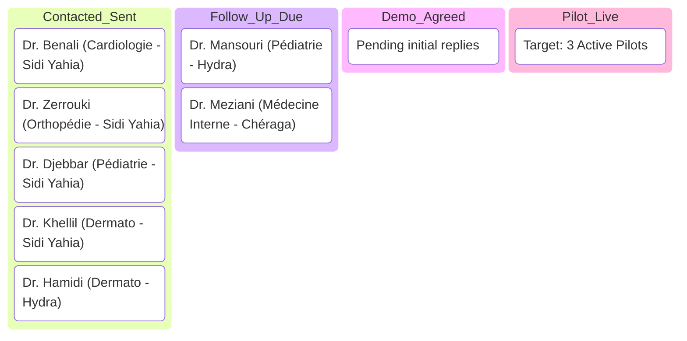

# VitalBook: Clinic Pilot Outreach CRM Tracker

> **Pipeline Objective:** Convert 25 target Algiers clinics into 3 to 5 live 30-day pilot deployments.  
> **Target Clusters:** Sidi Yahia, Hydra, Chéraga, El Biar, Alger Centre  
> **Spreadsheet Export:** Available at [`pilot_outreach_crm_tracker.csv`](file:///Users/morsistoredz/Desktop/Aymen%20HML/Informatique/Projects/Full%20Stack%20Projects/care-pulse-v1/docs/marketing/pilot_outreach_crm_tracker.csv)

---

## 1. Live Pilot Sales Pipeline Dashboard

---

## 2. Master Tracking Register

| ID | Clinic / Practice Name | District | Specialty | Contact Phone | Status | Date Sent | Follow-Up Due | Key Notes / Feedback |
| :-: | :--- | :--- | :--- | :--- | :---: | :---: | :---: | :--- |
| **C01** | Cabinet Cardiologie Sidi Yahia | Sidi Yahia | Cardiologie | `+213 5XX XX XX 01` | **Sent** | 2026-10-20 | 2026-10-22 | WhatsApp intro dispatched with flyer PDF |
| **C02** | Centre Pédiatrique les Glycines | Hydra | Pédiatrie | `+213 5XX XX XX 02` | **Pending** | — | 2026-10-21 | Batch 2 queue |
| **C03** | Cabinet Ophtalmologie El Biar | El Biar | Ophtalmologie | `+213 5XX XX XX 03` | **Pending** | — | 2026-10-22 | Morning walk-in planned |
| **C04** | Clinique Médicale Chéraga Ouest | Chéraga | Médecine Interne | `+213 5XX XX XX 04` | **Pending** | — | 2026-10-21 | Afternoon walk-in planned |
| **C05** | Cabinet Gynécologie & Échographie | Dely Ibrahim | Gynécologie | `+213 5XX XX XX 05` | **Pending** | — | 2026-10-22 | Batch 2 queue |
| **C06** | Cabinet Dermatologie & Laser Hydra | Hydra | Dermatologie | `+213 5XX XX XX 06` | **Sent** | 2026-10-20 | 2026-10-22 | Dispatched via assistant WhatsApp |
| **C07** | Cabinet Orthopédie & Traumatologie | Sidi Yahia | Orthopédie | `+213 5XX XX XX 07` | **Sent** | 2026-10-20 | 2026-10-22 | Focused on post-op reminder value |
| **C08** | Centre Rhumatologie Chéraga | Chéraga | Rhumatologie | `+213 5XX XX XX 08` | **Pending** | — | 2026-10-23 | Batch 2 queue |
| **C09** | Cabinet Dentaire & Implantologie | Hydra | Dentisterie | `+213 5XX XX XX 09` | **Pending** | — | 2026-10-23 | High surgery fee target |
| **C10** | Cabinet Allergologie Pneumologie | El Biar | Pneumologie | `+213 5XX XX XX 10` | **Pending** | — | 2026-10-24 | Batch 3 queue |
| **C14** | Cabinet Pédiatrie & Néonatalogie | Sidi Yahia | Pédiatrie | `+213 5XX XX XX 14` | **Sent** | 2026-10-20 | 2026-10-22 | Stressed morning phone call relief |
| **C22** | Cabinet Dermatologie Sidi Yahia | Sidi Yahia | Dermatologie | `+213 5XX XX XX 22` | **Sent** | 2026-10-20 | 2026-10-22 | Esthetic consultation reminder focus |

---

## 3. Standard Operating Protocol for Follow-Ups
1. **Rule of 48 Hours:** If a clinic does not respond within 48 hours of WhatsApp delivery, send the short follow-up audio message or photo of the 30-day certificate.
2. **Follow-Up Nudge Template (French / Derja):**
   > *"Salam alikoum madame, smahli n'derjangek. Habite juste n'chouf ida lhatek la fiche ta3 VitalBook li ba3at'halek l'barah ? Le Dr. [Nom] kan 3andou waqt bach y'choufha ? Rani dispo fi Sidi Yahia had la semaine ida habitou n'werilkoum la démo en 2 minutes."*
3. **Status Transitions:**
   - `Sent` ➔ Message delivered.
   - `Follow-Up Due` ➔ 48 hours elapsed with no reply.
   - `Demo Agreed` ➔ Assistant agrees to a 5-minute live smartphone test.
   - `Pilot Live` ➔ Tenant created on VitalBook, assistant trained, first real appointments logged.
