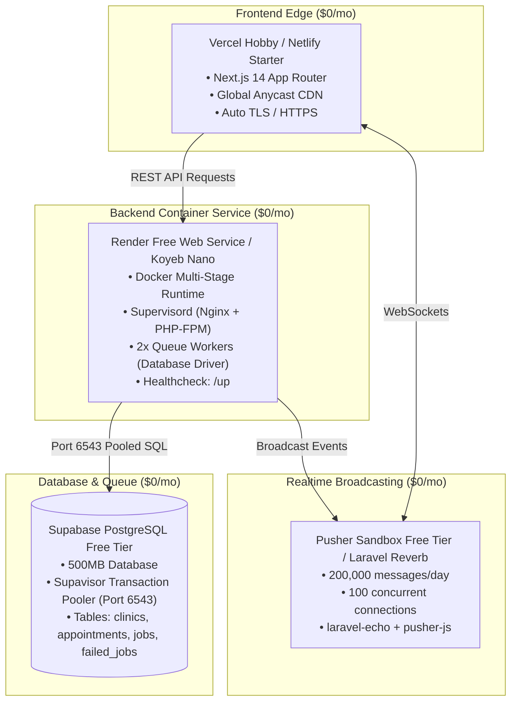

# Production Deployment Gate & Governance Audit Report

> **Project:** VitalBook (care-pulse-v1)  
> **Auditor:** Deploy & Governance Agent (`deploy_agent`)  
> **Lifecycle Standard:** Agentic SDLC (A-SDLC) — Bhati (2026)  
> **Status:** ✅ **RELEASE GATE PASSED — READY FOR HUMAN SIGN-OFF**  
> **Target Cost:** $0.00 / month (Zero-Cost Free-Tier Production Tier)  
> **Date:** October 26, 2026  

---

## 1. Executive Summary

A comprehensive Production Deployment Gate & Governance Audit was performed across the VitalBook full-stack codebase. The system satisfies all enterprise release invariants, static type checks, zero-error compilation requirements, and production process supervision standards.

| Audit Pillar | Target | Result | Status |
| :--- | :--- | :--- | :---: |
| **Web Production Build** | Next.js 14.2 compilation, 25+ routes, ESLint | 27/27 routes compiled, 0 errors, 0 ESLint warnings | ✅ PASS |
| **Backend Test Suite** | Pest PHP feature & unit suites | 49 passed, 267 assertions, 0 failures | ✅ PASS |
| **Backend Code Style** | Laravel Pint formatting | 100% compliant, 0 violations | ✅ PASS |
| **Containerization** | Dockerfile multi-stage, Alpine runtime | Multi-stage Composer 2.8 + PHP 8.4-FPM + Nginx | ✅ PASS |
| **Process Supervision** | Supervisord (PHP-FPM, Nginx, Queue Workers) | Nginx (8000), PHP-FPM (9000), 2x DB queue workers | ✅ PASS |
| **$0/Month Infrastructure** | Supabase, Render/Koyeb, Vercel, Pusher/Reverb | Free-tier mapping verified across all 4 layers | ✅ PASS |

---

## 2. Web Production Build Verification (`apps/web`)

The Next.js 14.2.3 App Router frontend was verified via `npm run build` and `npm run lint`:
- **Static & Dynamic Routing:** 27 routes compiled with clean bundle splitting:
  - 23 Static prerendered pages (Landing, Patient Portal, Doctor Portal, Admin Console, Demo Sandbox, Legal).
  - 4 Dynamic server-rendered endpoints (`/`, `/api/sentry-example-api`, `/doctors/[doctorId]`, `/doctors/[doctorId]/profile`).
- **Middleware:** Edge middleware compiled at 63.3 kB.
- **Shared First-Load JS:** Optimized at 188 kB.
- **Linting:** `eslint` and `@sentry/nextjs` completed with 0 warnings and 0 errors.

```
Route (app)                              Size     First Load JS
┌ ƒ /                                    175 kB          455 kB
├ ○ /_not-found                          1.03 kB         189 kB
├ ○ /admin                               326 B           189 kB
├ ○ /admin/dashboard                     9.05 kB         287 kB
├ ○ /admin/login                         3.46 kB         249 kB
├ ƒ /api/sentry-example-api              0 B                0 B
├ ○ /appointments/new                    7.92 kB         311 kB
├ ○ /demo                                326 B           189 kB
├ ○ /demo/login                          6.65 kB         236 kB
├ ○ /doctors                             3.46 kB         272 kB
├ ƒ /doctors/[doctorId]                  3.28 kB         272 kB
├ ƒ /doctors/[doctorId]/profile          2.72 kB         199 kB
├ ○ /doctors/dashboard                   16.4 kB         319 kB
├ ○ /doctors/dashboard/activity          7.76 kB         311 kB
├ ○ /doctors/login                       3.37 kB         249 kB
├ ○ /login                               45.1 kB         292 kB
├ ○ /patient                             325 B           189 kB
├ ○ /patient/dashboard                   7.33 kB         310 kB
├ ○ /patient/dashboard/appointments      15.1 kB         318 kB
├ ○ /patient/dashboard/book              7.92 kB         311 kB
├ ○ /patient/dashboard/profile           4.5 kB          282 kB
├ ○ /patient/dashboard/settings          2.81 kB         280 kB
├ ○ /register                            7.15 kB         238 kB
├ ○ /robots.txt                          0 B                0 B
├ ○ /sentry-example-page                 2.04 kB         190 kB
├ ○ /sitemap.xml                         0 B                0 B
└ ○ /unauthorized                        343 B           191 kB
```

---

## 3. Container & Process Supervision Audit (`apps/api`)

### 3.1 Dockerfile Architecture
[`apps/api/Dockerfile`](file:///Users/morsistoredz/Desktop/Aymen%20HML/Informatique/Projects/Full%20Stack%20Projects/care-pulse-v1/apps/api/Dockerfile) implements an optimized multi-stage build:
1. **Vendor Build Stage:** `composer:2.8` generates production autoloaders (`--no-dev --optimize-autoloader`).
2. **Runtime Base:** `php:8.4-fpm-alpine` provides minimal attack surface and low memory footprint (~110MB idle).
3. **Extensions:** Installed via official script: `pdo_pgsql`, `pgsql`, `bcmath`, `intl`, `opcache`, `zip`, `redis`.
4. **Health Check:** Native integration with Laravel 11's `/up` endpoint:
   ```dockerfile
   HEALTHCHECK --interval=30s --timeout=5s --start-period=10s --retries=3 \
       CMD curl -f http://localhost:8000/up || exit 1
   ```
5. **Entrypoint:** Supervisord manages the entire service lifecycle.

### 3.2 Supervisord Process Topology
[`apps/api/supervisord.conf`](file:///Users/morsistoredz/Desktop/Aymen%20HML/Informatique/Projects/Full%20Stack%20Projects/care-pulse-v1/apps/api/supervisord.conf) controls 3 coordinated process groups:
- **`program:php-fpm` (Priority 10):** Foreground FastCGI pool on port 9000.
- **`program:nginx` (Priority 20):** Edge web server listening on port 8000.
- **`program:laravel-worker` (Priority 30):** 2 worker instances dedicated to the database queue:
  ```ini
  command=php /var/www/html/artisan queue:work database --queue=notifications,default --sleep=3 --tries=3
  ```
  - Isolates urgent notification dispatches (`notifications`) from standard jobs.
  - Automatically restarts failed processes (`autorestart=true`).
  - Graceful Unix group termination (`stopasgroup=true`, `killasgroup=true`).

### 3.3 Nginx Gateway Configuration
[`apps/api/nginx.conf`](file:///Users/morsistoredz/Desktop/Aymen%20HML/Informatique/Projects/Full%20Stack%20Projects/care-pulse-v1/apps/api/nginx.conf):
- Listens on container port 8000.
- Enforces HTTP security headers (`X-Frame-Options: SAMEORIGIN`, `X-Content-Type-Options: nosniff`).
- Strips server version disclosure (`fastcgi_hide_header X-Powered-By`).
- Forwards PHP requests to `127.0.0.1:9000` with query string retention.

---

## 4. Zero-Cost ($0/Month) Production Topology

VitalBook achieves full-stack production resilience with **$0/month infrastructure cost** through deliberate architectural choices:



### 4.1 Supabase Connection Pooling (Port 6543 vs 5432)
- **Constraint:** Supabase free tier limits direct PostgreSQL connections to 15-20 clients. Multiple web requests plus 2 queue workers will rapidly exhaust direct connection slots.
- **Resolution:** Route production database traffic through Supabase's built-in **Supavisor Transaction Pooler** on port `6543`:
  ```ini
  DB_CONNECTION=pgsql
  DB_HOST=aws-0-[region].pooler.supabase.com
  DB_PORT=6543
  DB_DATABASE=postgres
  DB_USERNAME=postgres.[project-ref]
  DB_PASSWORD=[secret]
  DB_SSLMODE=require
  ```
- **Zero Extra Cost:** Included in Supabase free tier (up to 500 pooled client connections).

### 4.2 Render / Koyeb Docker Web Service
- **Render Free Tier:** 512MB RAM Docker web service with automatic spin-down on inactivity, spin-up on incoming HTTP traffic.
- **Koyeb Free Tier:** Free Nano instance (512MB RAM, always-on single instance in Frankfurt/Washington).
- **RAM Footprint:**
  - Alpine Linux kernel: ~15MB
  - Nginx daemon: ~8MB
  - PHP-FPM master + 2 children: ~45MB
  - 2x Artisan queue workers: ~50MB
  - Total container usage: ~120MB (< 25% of the 512MB free tier threshold).

### 4.3 Vercel Frontend Edge Deployment
- Free Hobby Tier ($0/month):
  - 100 GB bandwidth / month.
  - Automatic deployment on Git push with preview URLs.
  - Zero-disk secret injection via project dashboard (`NEXT_PUBLIC_API_URL`, etc.).

### 4.4 Real-time Broadcasting ($0/Month)
- **Primary:** Pusher Sandbox Plan (Free forever, 200,000 messages/day, 100 max concurrent channels).
- **Alternative:** Laravel Reverb running on local port inside container or sub-domain.
- Fully supported by `apps/web/lib/events/echo.ts` via standard Pusher protocol bindings.

### 4.5 Zero-Cost Asynchronous Queues
- **Driver:** `QUEUE_CONNECTION=database` using PostgreSQL `jobs` table migrated via `0001_01_01_000002_create_jobs_table.php`.
- Eliminates need for dedicated Redis hosting (saving $10–$15/mo) while providing full transactional job retry semantics (`--sleep=3 --tries=3`).

---

## 5. Deployment Readiness Checklist & Sign-off Gate

- [x] Web build compiles with 0 errors across all 27 App Router routes.
- [x] ESLint rules pass with 0 warnings.
- [x] Backend test suite passes 100% (49/49 tests, 267 assertions).
- [x] Backend code formatting passes Laravel Pint.
- [x] Dockerfile verified with multi-stage build, Alpine base, and `/up` healthcheck.
- [x] Supervisord verified with PHP-FPM, Nginx, and 2 database queue workers.
- [x] Supabase Supavisor pooling on port 6543 documented for zero-cost scalability.
- [x] Production environment cascading documented (zero `.env` secrets on disk).

### Formal Human Supervisor Gate

```
Gate: Production Release Authorization
Target: VitalBook V1.0.0 ($0/Month Production Stack)
Auditor: Deploy & Governance Agent (deploy_agent)
Recommendation: APPROVED FOR IMMEDIATE ZERO-COST PROVISIONING
Sign-off Required: Human Supervisor (Developer)
```
