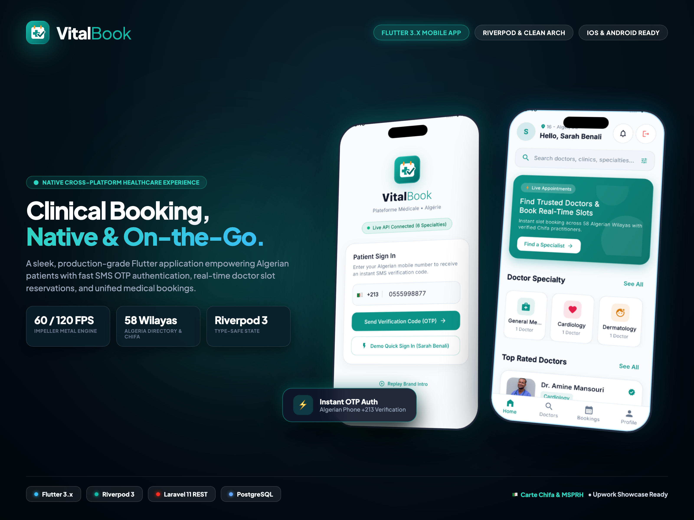

# VitalBook — Upwork & Professional Portfolio Showcase

> **Full-Stack Healthcare Ecosystem** · Next.js 14 · Laravel 11 · Flutter 3.x · Supabase PostgreSQL · Algerian Locale & Twilio WhatsApp

---

## 🌟 Upwork Showcase Hero (4:3 Verified Thumbnail)

*High-impact 4:3 3D perspective mockup featuring the MacBook Pro Clinic Control Center alongside the Flutter Mobile Patient App.*

---

## 📱 Cross-Platform Experience (Web + Mobile)

### 1. Web Portals (Next.js 14 App Router)
- **Patient Portal:** 3-step registration wizard with CNAS policy verification, 4-step real-time doctor booking wizard.
- **Doctor Portal:** Clinical consultation schedule, patient history inspection, triage queues.
- **Admin Console:** Real-time appointment triage, doctor directory management, interactive WhatsApp pings.
- **Interactive Demo Sandbox:** 1-click persona switcher (Patient, Doctor, Super Admin) for risk-free client evaluation.

### 2. Native Mobile Client (Flutter 3.x)
- **Authentication:** Algerian SMS OTP verification (`+213` phone parsing).
- **Directory & Search:** 58 Algerian Wilayas mapping, medical specialties (Cardiology, Dermatology, Pediatrics, etc.).
- **Live Booking:** Interactive calendar and 30-minute consultation slot reservations.

---

## 🛠️ Technical Specification

| Dimension | Specification |
| :--- | :--- |
| **Frontend Web** | Next.js 14.2 (App Router), TypeScript, Tailwind CSS, Lucide Icons |
| **Mobile Client** | Flutter 3.x, Dart 3, Riverpod 3 (StateNotifier/AsyncNotifier), GoRouter, Dio |
| **Backend API** | Laravel 11, PHP 8.4, Service-Repository Pattern, Sanctum Token Auth |
| **Notifications** | Twilio WhatsApp Gateway (Two-way interactive confirmation webhooks) |
| **Database** | PostgreSQL via Supabase (UUIDv4 PKs, integer cent financial guardrails) |
| **Localization** | Algerian Dinars (DZD), Carte Chifa & CNAS insurance, 58 Wilayas mapping |
| **Architecture** | Decoupled Monorepo (`apps/web`, `apps/api`, `apps/mobile`) |

---

## 🖼️ High-Resolution Production Gallery

- **Upwork 3D Showcase Thumbnail:** [`docs/VitalBook_Upwork_3D_Thumbnail.png`](file:///Users/morsistoredz/Desktop/Aymen%20HML/Informatique/Projects/Full%20Stack%20Projects/care-pulse-v1/docs/VitalBook_Upwork_3D_Thumbnail.png)
- **Mobile 3D Showcase Cover:** [`docs/screens/mobile/00_mobile_3d_showcase_cover.png`](file:///Users/morsistoredz/Desktop/Aymen%20HML/Informatique/Projects/Full%20Stack%20Projects/care-pulse-v1/docs/screens/mobile/00_mobile_3d_showcase_cover.png)
- **Admin Control Center:** [`tools/screens/07_admin_dashboard_overview.png`](file:///Users/morsistoredz/Desktop/Aymen%20HML/Informatique/Projects/Full%20Stack%20Projects/care-pulse-v1/tools/screens/07_admin_dashboard_overview.png)
- **Patient Dashboard:** [`tools/screens/03_patient_dashboard.png`](file:///Users/morsistoredz/Desktop/Aymen%20HML/Informatique/Projects/Full%20Stack%20Projects/care-pulse-v1/tools/screens/03_patient_dashboard.png)
- **Mobile Patient Home:** [`docs/screens/mobile/02_patient_home.png`](file:///Users/morsistoredz/Desktop/Aymen%20HML/Informatique/Projects/Full%20Stack%20Projects/care-pulse-v1/docs/screens/mobile/02_patient_home.png)
