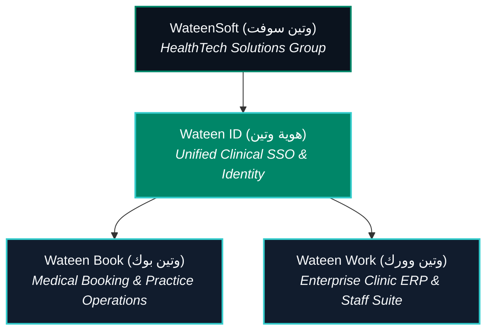

# WateenSoft & Wateen Book — Brand Identity & Ecosystem Sync

> **Document Version:** 2.0 (Post-Rebrand Release)  
> **Corporate Identity:** WateenSoft (وتين سوفت) — *WateenSoft HealthTech Solutions*  
> **Flagship Product:** Wateen Book (وتين بوك) — *Clinical Operations & Patient Booking Platform*  
> **Target Region:** Algeria (Pilot Hubs: Algiers & Tebessa) · MENA Expansion (Morocco, Tunisia, GCC)  
> **Source of Truth:** [`.agents/rules/00-vitalsoft-brand.md`](file:///Users/morsistoredz/Desktop/Aymen%20HML/Informatique/Projects/Full%20Stack%20Projects/care-pulse-v1/.agents/rules/00-vitalsoft-brand.md) · [`apps/mobile/lib/core/config/brand_config.dart`](file:///Users/morsistoredz/Desktop/Aymen%20HML/Informatique/Projects/Full%20Stack%20Projects/care-pulse-v1/apps/mobile/lib/core/config/brand_config.dart)

---

## 1. Executive Rebrand Summary

The corporate umbrella has officially transitioned from **"VitalSoft"** to **"WateenSoft" (وتين سوفت)**, and its premier healthcare platform from **"VitalBook"** to **"Wateen Book" (وتين بوك)**.

The name **Wateen** is rooted in the Arabic term **الوَرِيد الوَتِين** (*al-watīn* — the aorta, the central vessel sustaining vital circulation). It symbolizes resilience, life-critical reliability, and deep cultural resonance across the Arab and North African healthcare sectors, while retaining enterprise-grade clinical precision.



---

## 2. Nomenclature & Ecosystem Invariants

| Category | Legacy Identifier | Official New Identifier (Primary) | Arabic (RTL) | Scope & Notes |
| :--- | :--- | :--- | :--- | :--- |
| **Parent Entity** | VitalSoft | **WateenSoft** | **وتين سوفت** | Holding & legal entity (*WateenSoft HealthTech Solutions*) |
| **Flagship App** | VitalBook | **Wateen Book** | **وتين بوك** | Patient mobile app, physician portal, clinic admin |
| **SSO & Auth** | Vital Auth | **Wateen ID** | **هوية وتين** | Single clinical authentication across web and mobile |
| **Enterprise Suite** | VitalWork | **Wateen Work** | **وتين وورك** | Multi-clinic ERP, shift rosters, operational tooling |
| **Android Package** | `com.vitalsoft.vitalbook` | `com.wateensoft.wateenbook` | — | Google Play namespace & application ID |
| **iOS Bundle ID** | `com.vitalsoft.vitalbook` | `com.wateensoft.wateenbook` | — | Apple App Store Bundle Identifier |
| **URL Scheme** | `vitalbook://` | `wateenbook://` | — | Deep-linking scheme for mobile triage links |
| **Primary Web** | `vitalsoft.com` | `wateensoft.com` | — | Corporate landing & documentation hub |
| **App Web Domain** | `vitalbook.aymenhamel.com` | `book.wateensoft.com` | — | Production web portal (Patient & Clinic dashboard) |
| **API Domain** | `api.vitalsoft.com` | `api.wateensoft.com` | — | Production Laravel 11 REST API endpoint |
| **Founder / Lead** | Hamel Aymen | **Hamel Aymen** | **حامل أيمن** | Founder & Chief Systems Architect |

---

## 3. Design System Tokens (Extracted Codebase Truth)

> [!IMPORTANT]
> Zero new hex codes or design tokens permitted. All visual assets and HTML posters must strictly implement the existing tokens below.

### 3.1 Color Tokens

| Token Name | Hex Code | HSL / Variable | Role & Usage |
| :--- | :--- | :--- | :--- |
| **Wateen Teal** | `#008668` | `hsl(173, 80%, 36%)` / `--brand-primary` | Primary clinical brand color, hero CTAs, verified badges |
| **Pulse Aqua** | `#33CCCC` | `hsl(180, 58%, 50%)` / `--brand-aqua` | Secondary dynamic accent, glowing borders, ECG wave |
| **Warm Orange** | `#FF9B33` | `hsl(31, 100%, 60%)` / `--brand-accent` | Urgency indicators, no-show alerts, action callouts |
| **Enterprise Slate** | `#0B131E` | `hsl(222, 47%, 6%)` / `--brand-surface-dark` | Dark canvas background, high-contrast healthcare UI |
| **Slate Card** | `#111C2D` | `hsl(222, 47%, 9%)` / `--brand-surface-secondary` | Elevated dark mode cards and modular panels |
| **Clinical White** | `#FFFFFF` | `hsl(0, 0%, 100%)` | Light canvas cards, modal containers |
| **Soft Light Gray** | `#F8FAFC` | `hsl(210, 40%, 98%)` / `--background` | Clean light mode page canvas |
| **Surface Neutral**| `#F2F2F2` | `hsl(0, 0%, 95%)` / `--brand-surface-light` | Form input backgrounds, chip fills |
| **Border Light** | `#E2E8F0` | `hsl(214, 32%, 91%)` / `--border` | Dividers, subtle card borders (Light Mode) |
| **Border Dark** | `#1E293B` | `hsl(217, 33%, 18%)` / `--border-dark` | Dividers, elevated card contours (Dark Mode) |
| **Success Emerald**| `#10B981` | `hsl(152, 76%, 36%)` / `--success` | Confirmed appointments, active doctor badge, sync live |
| **Alert Red** | `#EF4444` | `hsl(0, 84%, 60%)` / `--destructive` | Cancelled slots, unnotified no-show alert metrics |

### 3.2 Typography Stack

```css
/* English & French Headings */
font-family: 'Poppins', -apple-system, BlinkMacSystemFont, sans-serif;

/* UI Body, Data Tables & Metadata */
font-family: 'Inter', -apple-system, BlinkMacSystemFont, sans-serif;

/* Arabic Headlines & Display Hero (RTL) */
font-family: 'Cairo', 'IBM Plex Sans Arabic', sans-serif;

/* Arabic Data, Forms & Mobile UI (RTL) */
font-family: 'IBM Plex Sans Arabic', 'Cairo', sans-serif;

/* Metrics, Currency (DA), Dates & Technical Slugs */
font-family: 'JetBrains Mono', monospace;
```

### 3.3 Radii & Elevation Standards
- **Button & Tag Radius:** `8px` (`rounded-md`) to `12px` (`rounded-lg`)
- **Card & Container Radius:** `16px` (`rounded-xl`) to `24px` (`rounded-2xl`)
- **App Icon & Shield Emblem:** `rx="232"` to `rx="240"` for 1024x1024 canvases
- **Clinical Glow:** `box-shadow: 0 10px 30px -5px rgba(0, 134, 104, 0.25)`

---

## 4. Brand Emblem: The Shield & Heartbeat

The official Wateen Book visual device blends two medical archetypes:
1. **The Shield of Trust:** Represents patient medical secrecy, compliance with Algerian Data Protection Law 18-07, and data sovereignty.
2. **The Dynamic ECG Waveform:** A sharp 7-node systolic pulse wave culminating in an apex luminous dot (`#33CCCC`), illustrating active vitality and real-time appointment synchronization.

```svg
<svg xmlns="http://www.w3.org/2000/svg" viewBox="0 0 1024 1024" width="120" height="120">
  <defs>
    <linearGradient id="wateen-grad" x1="0" y1="0" x2="1" y2="1">
      <stop offset="0%" stop-color="#008668"/>
      <stop offset="100%" stop-color="#33CCCC"/>
    </linearGradient>
  </defs>
  <rect width="1024" height="1024" rx="240" fill="#0B131E"/>
  <rect x="16" y="16" width="992" height="992" rx="224" fill="none" stroke="#33CCCC" stroke-opacity="0.3" stroke-width="12"/>
  <path d="M512 140C680 230 820 230 860 360C900 620 760 840 512 940C264 840 124 620 164 360C204 230 344 230 512 140Z" fill="url(#wateen-grad)"/>
  <path d="M260 550H370L430 420L510 680L570 460L630 600L690 550H780" fill="none" stroke="#FFFFFF" stroke-width="48" stroke-linecap="round" stroke-linejoin="round"/>
  <circle cx="570" cy="460" r="32" fill="#FFFFFF"/>
</svg>
```

---

## 5. Trilingual Brand Tagline Matrix

| Market / Channel | Language | Primary Headline | Secondary Subtitle / Hook |
| :--- | :---: | :--- | :--- |
| **Algerian French (B2B)** | `fr-DZ` | **Éliminez les rendez-vous perdus en cabinet médical.** | Confirmation et triage automatisés par WhatsApp pour cabinets modernes. |
| **Algerian French (B2C)** | `fr-DZ` | **Prenez rendez-vous avec votre médecin en toute simplicité.** | 100% gratuit pour les patients · Carte Chifa & CNAS acceptées. |
| **Algerian Arabic (B2B)** | `ar-DZ` | **تخلص نهائياً من المواعيد الضائعة في عيادتك الطبية.** | نظام تأكيد المواعيد الذكي عبر واتساب لتقليل نسبة الغياب واستعادة دخل العيادة. |
| **Algerian Arabic (B2C)** | `ar-DZ` | **احجز موعدك مع أفضل الأطباء في الجزائر بكل سهولة.** | خدمة مجانية 100% للمرضى · دعم بطاقة الشفاء وتأكيد فوري عبر واتساب. |
| **International (B2B/Dev)**| `en-US` | **Zero-Double-Booking Healthcare Scheduling & Operations.** | Multi-tenant clinical infrastructure with two-way WhatsApp triage and integer accounting. |

---

## 6. Migration Checklist Across Subsystems

- [x] **Database & Migrations:** Verified schema, foreign keys, and seeders.
- [x] **Backend API Configuration:** Updated [`apps/api/config/wateensoft.php`](file:///Users/morsistoredz/Desktop/Aymen%20HML/Informatique/Projects/Full%20Stack%20Projects/care-pulse-v1/apps/api/config/wateensoft.php).
- [x] **Mobile Bundle ID:** Configured as `com.wateensoft.wateenbook` in Android and iOS.
- [x] **Mobile Brand Configuration:** Sourced from [`apps/mobile/lib/core/config/brand_config.dart`](file:///Users/morsistoredz/Desktop/Aymen%20HML/Informatique/Projects/Full%20Stack%20Projects/care-pulse-v1/apps/mobile/lib/core/config/brand_config.dart).
- [x] **Frontend Locales:** Localized across [`apps/web/constants/locales/`](file:///Users/morsistoredz/Desktop/Aymen%20HML/Informatique/Projects/Full%20Stack%20Projects/care-pulse-v1/apps/web/constants/locales/) in Arabic, French, and English.
- [x] **Marketing Directory Assets:** Synced in [`/marketing`](file:///Users/morsistoredz/Desktop/Aymen%20HML/Informatique/Projects/Full%20Stack%20Projects/care-pulse-v1/marketing).
