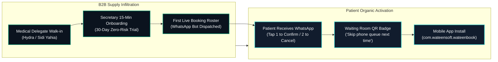
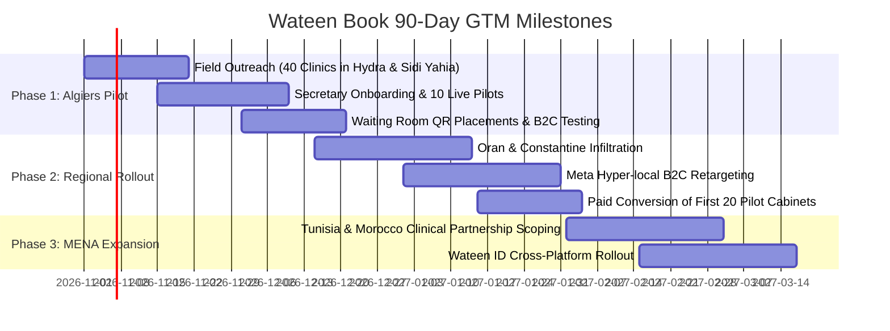

# Wateen Book — Go-To-Market Strategy: Algeria & MENA

> **Product:** Wateen Book (وتين بوك)  
> **Parent Company:** WateenSoft (وتين سوفت)  
> **Target Markets:** Phase 1: Algeria (Algiers & Tebessa) · Phase 2: Oran, Constantine, Sétif · Phase 3: Maghreb & MENA (Tunisia, Morocco, GCC)  
> **Commercial Model:** B2B-First Supply Acquisition (Clinics & Cabinets) $\rightarrow$ Patient Organic Pull

---

## 1. Executive GTM Hypothesis & Market Dynamics

In private outpatient healthcare across Algeria and North Africa, **B2C-first digital advertising fails**:
- Patients do not switch doctors because of an app; they book whoever their trusted doctor tells them to use.
- Over 90% of bookings happen through phone calls to medical receptionists (*secrétaires médicales*).
- Doctors suffer an acute financial hemorrhage: **up to 35% no-show rates** (4 to 6 patients daily), creating an average **360,000 DA monthly revenue loss** per consultation room.

**The Solution:** An unassailable **B2B-First Strategy**. By winning the clinic receptionist and providing a zero-friction, two-way WhatsApp confirmation system, Wateen Book locks in the consultation supply. Patients naturally adopt the platform via appointment confirmations and waiting-room QR badges.

---

## 2. Target Territory & Pilot Clusters (Algeria 2026)

### 2.1 Algiers High-Density Cluster (Wilaya 16)
Selected for high private fee structures (3,000 DA – 5,000 DA per consultation) and high patient volume:
- **Sidi Yahia & Hydra:** Elite private specialists (Cardiology, Dermatology, Orthopedics, Pediatrics).
- **El Biar & Chéraga:** Polyclinics, imaging centers, and multi-specialty clinical groups.
- **Kouba & Dely Ibrahim:** Surgical practices, high-turnover dental clinics.

### 2.2 Provincial High-Trust Pilot (Wilaya 12 - Tébessa)
Selected to validate regional cross-border and inland adoption where patients travel up to 80 km for scheduled appointments, making booking confirmation critical to avoid wasted travel days.

---

## 3. Commercial Pricing Tiers & Unit Economics (in DZD)

All pricing is transparently structured in **Dinars Algériens (DA)**, invoice-backed, and tax-deductible for registered practices:

| Plan | Monthly Fee | Annual Commitment | Core Features | Target Customer |
| :--- | :---: | :---: | :--- | :--- |
| **30-Day Pilot** | **0 DA** | None | Full feature access, 100 WhatsApp confirmations, hands-on receptionist setup | New prospective clinics |
| **Cabinet Solo** | **8 500 DA** | 85 000 DA *(2 mo. free)* | 1 Doctor, 1 Secretary, unlimited local bookings, 300 automated WhatsApp messages, Carte Chifa tagging | Independent practitioner |
| **Cabinet Pro** | **18 500 DA** | 185 000 DA *(2 mo. free)* | Up to 3 Doctors, multi-calendar triage, 1,000 WhatsApp reminders, live waiting room monitor, analytics | Group practice / Specialty clinic |
| **Clinique Enterprise** | **45 000 DA+** | Custom SLA | Unlimited doctors, polyclinic triage, custom WhatsApp Business API sender, priority phone support | Private clinics & diagnostic centers |

### 3.1 The No-Brainer ROI Equation for Doctors
- **Daily Unnotified No-Shows:** 4 patients
- **Average Specialist Fee:** 3 000 DA
- **Daily Revenue Lost:** $4 \times 3\,000\text{ DA} = 12\,000\text{ DA}$
- **Monthly Revenue Lost (25 working days):** **300 000 DA – 360 000 DA**
- **Wateen Book Cabinet Solo Cost:** **8 500 DA/month**
- **ROI Threshold:** Recovering just **3 lost consultations per month** (out of 100+) completely pays for the subscription. Everything else is pure recovered clinic profit ($>35\times$ ROI).

---

## 4. The 3-Step Field Delegate Protocol

Medical secretaries (*secrétaires médicales*) are the ultimate gatekeepers. Delegates must adhere to the **Secretary-First Rule**:

1. **Phase 1: The Gatekeeper Respect & Empathy Opening (2 Minutes)**  
   Never ask for the doctor immediately during clinic hours. Greet the receptionist in warm Algerian French/Derja:  
   *"Salam alikoum madame. Je ne viens pas vous vendre un logiciel compliqué ni déranger la consultation du docteur. Je viens vous montrer comment économiser 2 heures d'appels chaque matin et ne plus jamais avoir de chaises vides."*
2. **Phase 2: The 45-Second Smartphone Live Demo**  
   The delegate types the receptionist's mobile number into the demo portal. Within 3 seconds, her phone buzzes with the official Wateen Book WhatsApp confirmation:  
   *"Tapez 1 pour confirmer, tapez 2 pour annuler."*  
   She taps **1**, and the delegate's screen instantly flips from yellow to **bright green**.
3. **Phase 3: The 30-Day Zero-Risk Trial Onboarding**  
   *"Nous vous offrons 30 jours sans carte ni engagement. Si vous n'avez pas gagné 2 heures par jour et sauvé des consultations d'ici 30 jours, on vous remercie avec le sourire."*

---

## 5. Regulatory & Compliance Architecture (Algeria & MENA)

- **Loi 18-07 relative à la protection des personnes physiques dans le traitement des données à caractère personnel:** Patient medical history and identifiers are encrypted at rest using AES-256 and never shared with third parties or advertisers.
- **Carte Chifa & CNAS Ready:** The booking triage wizard includes a dedicated toggle for Chifa cardholders, allowing clinics to pre-qualify insurance documents before the patient reaches the clinic counter.
- **Telecom & WhatsApp Business Compliance:** Automated alerts run through verified WhatsApp Business BSP endpoints with explicit opt-in triggers, preventing spam flags on local Djezzy, Mobilis, and Ooredoo cellular networks.

---

## 6. 90-Day Execution Roadmap & Milestones

---

## 7. Recommended Marketing & Management Tooling Stack

To preserve engineering focus and maintain a strict **2-ticket active Work-In-Progress (WIP) limit**, use this validated stack:

1. **HubSpot CRM (Free / Starter Tier):**
   - Manage the 40-clinic pipeline across stages: *Prospect Identified $\rightarrow$ Walk-in Completed $\rightarrow$ Demo Triggered $\rightarrow$ 30-Day Trial Active $\rightarrow$ Paid Contract Signed*.
   - Automated 48-hour WhatsApp reminder triggers for delegates.
2. **Meta Business Suite (Algiers Geofenced Ads):**
   - 5 km radius around Sidi Yahia and Hydra.
   - Creatives: Video carousel showing the secretary dashboard and WhatsApp confirmation.
3. **Linear or ClickUp (Sprint Execution):**
   - Strictly configured with a WIP limit of 2 active cards per marketer/developer.
   - Eliminates context-switching between field collateral, code releases, and store ASO.
