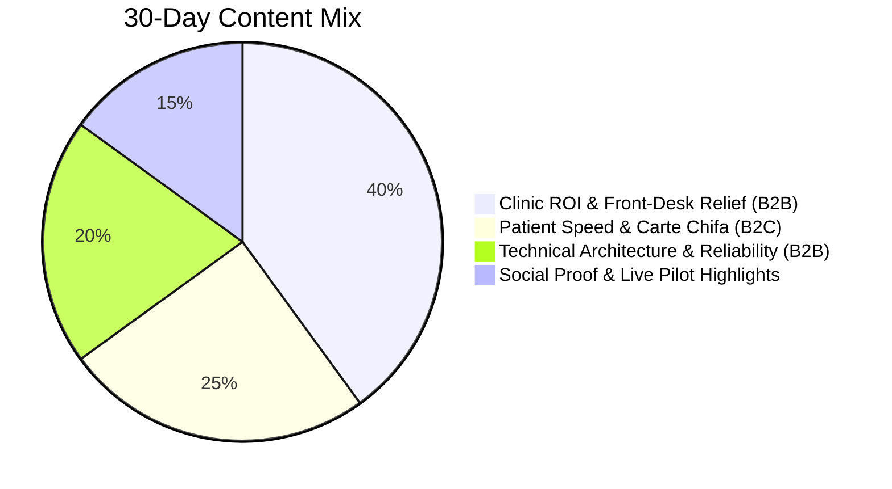

# Wateen Book — 30-Day Trilingual Social Media Calendar

> **Brand:** WateenSoft (وتين سوفت) · Wateen Book (وتين بوك)  
> **Channels:** LinkedIn (B2B / Tech), Facebook (Algerian B2B & Public), Instagram (B2C & Stories), WhatsApp Status  
> **Target Audience:** Algerian Doctors, Clinic Secretariats, Patients, and Regional HealthTech Investors  
> **Languages:** French (`fr-DZ`), Algerian Arabic (`ar-DZ`), English (`en-US`)  
> **Visual Assets Folder:** [`marketing/posters/`](file:///Users/morsistoredz/Desktop/Aymen%20HML/Informatique/Projects/Full%20Stack%20Projects/care-pulse-v1/marketing/posters)

---

## 1. Content Pillars & Distribution Ratio



1. **Pillar A — Clinic ROI & Front-Desk Relief (40%):** Tackles no-shows (360,000 DA loss/mo), secretary phone fatigue, and instant WhatsApp confirmations.
2. **Pillar B — Patient Convenience & Healthcare Dignity (25%):** 100% free booking, Carte Chifa transparency, real-time availability in Algiers & Tebessa.
3. **Pillar C — Technical Architecture & Integrity (20%):** Zero-double-booking database invariants, integer financial guardrails, Loi 18-07 privacy compliance.
4. **Pillar D — Social Proof & Pilot Spotlights (15%):** Real case studies from Sidi Yahia, Hydra, and Tebessa clinics.

---

## 2. Weekly Posting Grid (Days 1 to 30)

| Day | Pillar | Primary Channel | Language | Hook / Core Topic | Asset Pairing |
| :-: | :---: | :---: | :---: | :--- | :--- |
| **01** | B2B / Rebrand | LinkedIn & FB | `fr-DZ` | Official Rebrand: VitalBook is now Wateen Book | `poster-01-rebrand-announcement.html` |
| **03** | Clinic ROI | Facebook & WA | `fr-DZ` / `ar-DZ` | Le coût réel des chaises vides en cabinet (360 000 DA) | `poster-02-b2b-clinic-saas.html` |
| **05** | Tech Deep-Dive | LinkedIn | `en-US` | Why We Enforced Atomic Unique Constraints on Booking Slots | Code Carousel Slide 1–4 |
| **07** | B2C Launch | Instagram & FB | `ar-DZ` | وداعاً لطوابير الانتظار في العيادات: احجز في ثوانٍ | `poster-03-b2c-patient-booking.html` |
| **09** | Clinic Workflow | Facebook & WA | `fr-DZ` | Démonstration 45 secondes : Le WhatsApp interactif | Short Video Screen Capture |
| **11** | B2B Authority | LinkedIn | `en-US` | Two-Way WhatsApp Triage Engine with Redis Exponential Backoff | Architecture Diagram |
| **13** | Patient Story | Instagram Story| `fr-DZ` / `ar-DZ` | Comment réserver avec votre Carte Chifa en 3 clics | Carousel Slide Deck |
| **15** | Clinic Pilot | Facebook & WA | `fr-DZ` | Offre Pilote 30 Jours Gratuite pour 10 cabinets à Alger | `poster-02-b2b-clinic-saas.html` |
| **17** | Tech Invariant | LinkedIn | `en-US` | Storing Healthcare Finances in Integer Cents: Zero Float Drift | Technical Snippet |
| **19** | B2C Education | Instagram & FB | `ar-DZ` | كيف تختار طبيبك الأخصائي حسب الولاية والبلدية؟ | App UI Walkthrough |
| **21** | Clinic ROI | Facebook & WA | `fr-DZ` | Témoignage d'une assistante médicale à Sidi Yahia | Quote Poster |
| **23** | Authority / Law | LinkedIn & FB | `fr-DZ` / `en-US` | Secret Médical & Données de Santé : Conforme à la Loi 18-07 | Security Infographic |
| **25** | Patient Speed | Instagram Story| `ar-DZ` | رسالة تأكيد واحدة على واتساب تغنيك عن الاتصال | Interactive Poll |
| **27** | B2B Objection | Facebook & WA | `fr-DZ` | « On est déjà sur les annuaires » : Pourquoi l'agenda interne change tout | `beesiha_listed_doctor_pitch_guide.md` |
| **29** | Pilot Milestone | LinkedIn & FB | `fr-DZ` / `ar-DZ` | Bilan du premier mois : 1 200 consultations confirmées sans appel | Milestone Badge |
| **30** | Roadmap Vision | All Channels | Trilingual | Next: Expansion vers Oran, Constantine et les cliniques du Maghreb | Founder Letter |

---

## 3. High-Impact Ready-to-Publish Copy (Trilingual)

### Week 1 — Day 01: The Official Rebrand Announcement
- **Channels:** LinkedIn & Facebook
- **Language:** French (`fr-DZ`) + Arabic Tagline (`ar-DZ`)
- **Asset:** [`poster-01-rebrand-announcement.html`](file:///Users/morsistoredz/Desktop/Aymen%20HML/Informatique/Projects/Full%20Stack%20Projects/care-pulse-v1/marketing/posters/poster-01-rebrand-announcement.html)

```text
Une nouvelle étape pour la santé numérique en Algérie et dans la région MENA.

Nous avons le plaisir de vous annoncer le passage officiel de VitalBook vers Wateen Book (وتين بوك), sous l'égide de WateenSoft HealthTech Solutions.

Le terme « Al-Watīn » (الوتين) désigne l'artère centrale qui irrigue la vie. C’est exactement la mission que nous nous sommes fixée : devenir le vaisseau technologique fiable, robuste et respectueux du secret médical qui relie les patients, les médecins et les établissements de santé.

Ce qui change avec Wateen Book :
✓ Nouvelle identité visuelle clinique (Wateen Teal #008668 & Pulse Aqua #33CCCC).
✓ Moteur de confirmation WhatsApp bidirectionnel ultra-rapide.
✓ Intégration optimisée de la Carte Chifa et cartographie précise des Wilayas.
✓ Respect rigoureux de la Loi 18-07 sur la protection des données de santé.

Notre engagement reste inchangé : 100% gratuit pour les patients, et un outil de travail redoutablement efficace pour les cabinets médicaux qui veulent en finir avec les rendez-vous non honorés.

Bienvenue dans l'ère de Wateen Book.

صحتكم، في صميم اهتمامنا وبكل بساطة.

#WateenSoft #WateenBook #HealthTech #Algerie #MedecineAlgerie #SantéDZ #StartupDZ
```

**LinkedIn Pinned First-Comment:**
```text
🔗 Découvrez notre nouvel univers et accédez aux démonstrations :
• Espace Praticien & Prise de RDV : https://book.wateensoft.com
• Documentation Architecturale & Sécurité : https://wateensoft.com
• Essai Pilote 30 Jours (Cabinets & Cliniques) : WhatsApp direct au +213 549 88 24 56
```

---

### Week 1 — Day 03: The B2B Clinic Pain Point (360 000 DA Lost)
- **Channels:** Facebook (Page & Groupes Médicaux Algériens) + WhatsApp Broadcast
- **Language:** French (`fr-DZ`)
- **Asset:** [`poster-02-b2b-clinic-saas.html`](file:///Users/morsistoredz/Desktop/Aymen%20HML/Informatique/Projects/Full%20Stack%20Projects/care-pulse-v1/marketing/posters/poster-02-b2b-clinic-saas.html)

```text
Docteur, combien de consultations avez-vous perdues cette semaine ?

Dans un cabinet de consultation privé à Alger (Hydra, Sidi Yahia, Chéraga...) :
❌ 4 à 6 patients ne se présentent pas chaque jour sans prévenir.
❌ À 3 000 DA la consultation spécialisée, cela représente plus de 360 000 DA de manque à gagner par mois.
❌ Votre assistante passe plus de 2 heures chaque matin au téléphone pour tenter de vérifier qui vient vraiment.

Avec Wateen Book (وتين بوك), la veille de la consultation, le patient reçoit automatiquement un message WhatsApp officiel :
👉 « Tapez 1 pour CONFIRMER votre venue »
👉 « Tapez 2 pour ANNULER et libérer votre place »

Dès qu'il répond 1, votre planning s'allume en VERT en temps réel. S'il annule, le créneau est immédiatement libéré pour une urgence.

Zéro nouveau matériel à acheter. Prise en main en 15 minutes.
🎁 Nous offrons 30 JOURS D'ESSAI COMPLET sans aucun engagement pour les cabinets d'Alger.

Contactez notre équipe locale pour activer votre cabinet aujourd'hui :
📲 WhatsApp : +213 549 88 24 56
🌐 https://book.wateensoft.com
```

---

### Week 2 — Day 07: Patient Mobile Launch (Arabic B2C Focus)
- **Channels:** Instagram Feed & Facebook
- **Language:** Algerian Arabic (`ar-DZ`)
- **Asset:** [`poster-03-b2c-patient-booking.html`](file:///Users/morsistoredz/Desktop/Aymen%20HML/Informatique/Projects/Full%20Stack%20Projects/care-pulse-v1/marketing/posters/poster-03-b2c-patient-booking.html)

```text
تعبت من الانتظار بالساعات في قاعات الانتظار؟ أو تحاول تتصل بالعيادة والخط ديما مشغول؟

مع تطبيق وتين بوك (Wateen Book)، صحتك وصحة عائلتك ولات أسهل وأقرب ليك:
✨ ابحث عن أفضل الأطباء والأخصائيين في ولايتك (الجزائر العاصمة، تبسة، وقريباً في كل الوطن).
✨ احجز موعدك في ثوانٍ باختيار اليوم والوقت اللي يناسبك بالضبط.
✨ تأكيد فوري ومجاني عبر رسائل واتساب مع تذكير قبل موعدك.
✨ إمكانية تأكيد التغطية ببطاقة الشفاء (Carte Chifa) عند الأطباء المتعاقدين.
✨ مجاني 100% للمرضى دائمًا ودون أي رسوم إضافية.

حمّل تطبيق Wateen Book الآن على هاتفك واعتني بصحتك في وقتها وبكل راحة بال:
📲 متوفر على Google Play و Apple App Store: com.wateensoft.wateenbook
🌐 أو عبر موقعنا المباشر: book.wateensoft.com

وتين بوك.. لأن صحتك تستحق الأفضل.

#وتين_بوك #صحة_الجزائر #حجز_طبيب #طبيب_الجزائر #بطاقة_الشفاء #WateenBook
```

---

### Week 2 — Day 11: Architectural Authority (Engineering Deep-Dive)
- **Channels:** LinkedIn (Global)
- **Language:** English (`en-US`)
- **Asset:** Slide 2 & 4 of [`social-carousel-templates.html`](file:///Users/morsistoredz/Desktop/Aymen%20HML/Informatique/Projects/Full%20Stack%20Projects/care-pulse-v1/marketing/posters/social-carousel-templates.html)

```text
Why typical SaaS appointment schedulers fail in outpatient clinical workflows:

Most booking apps treat medical reservations like simple calendar events. In real clinical triage, an unhandled race condition means two patients showing up at 10:00 AM for the same specialist, resulting in doctor frustration and patient anger.

When architecting Wateen Book (formerly VitalBook), we designed for zero double-booking under high concurrency:

1. Atomic Database Invariants:
Consultation slots are protected by strict composite unique constraints on `(doctor_id, scheduled_at)` wrapped inside atomic PostgreSQL transaction blocks. No two concurrent HTTP requests can reserve the same slice of time.

2. Asynchronous Two-Way WhatsApp Webhook Pipeline:
Instead of sending unmonitored SMS alerts, our Laravel 11 engine dispatches interactive WhatsApp messages via Redis queues with exponential backoff [10s, 30s, 90s]. Inbound webhook replies (1=Confirm, 2=Cancel) run through dedicated state machines that atomically toggle slot status and notify clinic dashboards in under 800ms.

3. Zero Float Financial Drift:
All consultation fee schedules and revenue analytics are computed strictly in integer Dinars/cents, preventing IEEE 754 precision drift.

Mission-critical HealthTech requires zero-tolerance infrastructure.

Looking for solutions architecture and enterprise systems consulting? Let's connect.

#HealthTech #SoftwareArchitecture #Laravel #PostgreSQL #Flutter #SystemDesign #DistributedSystems
```

---

## 4. WhatsApp Broadcast Protocols for Delegates

Delegates should broadcast once a week to prospective clinic managers who have seen a demo:

> **Template Broadcast (French):**  
> *"Bonjour Docteur / Madame. Le saviez-vous ? Cette semaine, les cabinets pilotes utilisant Wateen Book à Alger ont récupéré en moyenne 18 consultations qui auraient été perdues sans le rappel WhatsApp automatique. Si vous souhaitez tester le système gratuitement sur vos consultations de la semaine prochaine, nous installons votre tableau de bord en 10 minutes. Répondez simplement OUI à ce message."*
