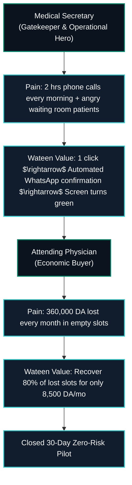
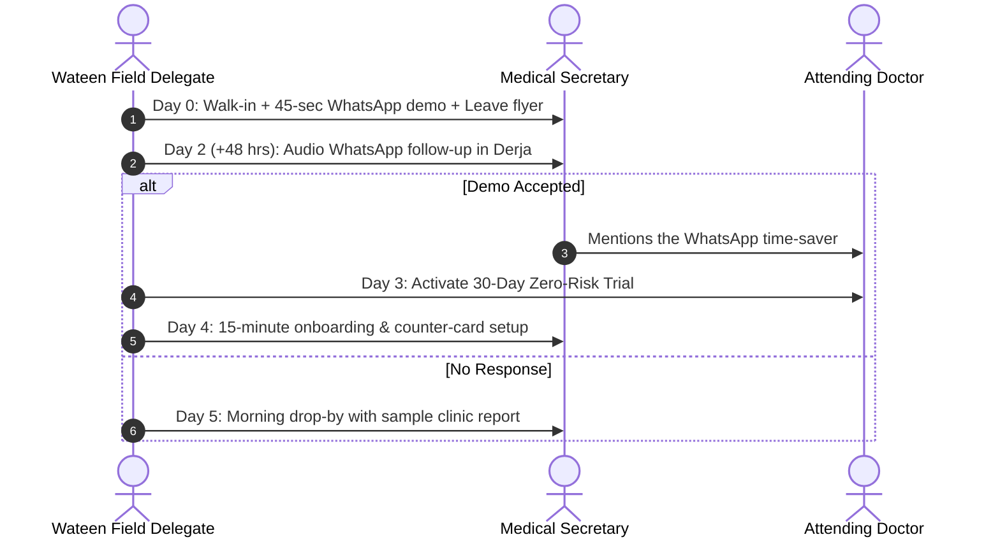

# Wateen Book — B2B Clinic Outreach Playbook & Sales Pitch

> **Product:** Wateen Book (وتين بوك)  
> **Parent Company:** WateenSoft (وتين سوفت)  
> **Audience:** Private Specialists, Multi-Specialty Clinics, Polyclinics, and Medical Secretariats  
> **Primary Territories:** Algiers (Sidi Yahia, Hydra, Chéraga, El Biar) · Tébessa · Oran · Constantine  
> **Collateral Pairing:** [`poster-02-b2b-clinic-saas.html`](file:///Users/morsistoredz/Desktop/Aymen%20HML/Informatique/Projects/Full%20Stack%20Projects/care-pulse-v1/marketing/posters/poster-02-b2b-clinic-saas.html) · Flyer PDF

---

## 1. The Core Philosophy: The Secretary is Your Sponsor

In Algerian private medical practice, **the medical secretary (*secrétaire médicale*) decides your fate in under 30 seconds**.
- If she perceives Wateen Book as "more work for her", she will block you from seeing the doctor.
- If she realizes Wateen Book will **free her from 2 hours of exhausting phone calls every morning**, she becomes your internal champion and convinces the doctor to sign.

---

## 2. In-Person Walk-In Script (French & Algerian Derja)

### Step 1: The Secretary-First Opening (Do NOT ask for the doctor immediately)
> **Delegate:** *"Salam alikoum madame. Smahli n'derjangek wesh raki ? Je sais que vous êtes très occupée avec les patients, je ne prends que 45 secondes chrono.*
> 
> *Je ne viens pas vous vendre du matériel lourd ni déranger la consultation du docteur. Je viens vous montrer comment ne plus jamais passer 2 heures au téléphone le matin à vérifier qui vient et qui ne vient pas."*

### Step 2: The 45-Second Smartphone Live Test (The Magic Buzzer)
> **Delegate:** *"Regardez sur mon téléphone : donnez-moi juste votre prénom et votre numéro WhatsApp.*
> *(Delegate types it into the demo screen in 5 seconds and taps 'Enregistrer')*
> *Regardez maintenant votre téléphone..."*
> 
> *(The secretary's phone immediately buzzes with an official Wateen Book WhatsApp message)*
> 
> **WhatsApp Notification Text:**
> *« Bonjour Fatima, votre RDV au Cabinet du Dr. Benali est prévu le Jeudi à 10h00.*
> *👉 Tapez 1 pour CONFIRMER votre venue.*
> *👉 Tapez 2 pour ANNULER et libérer votre place. »*
> 
> **Delegate:** *"Tapez 1 sur votre WhatsApp pour voir ce qui se passe..."*
> 
> *(She taps 1. In less than 1 second, the delegate's screen flashes to a vibrant GREEN checkmark)*
> 
> **Delegate:** *"Voilà ! C'est tout. Le patient confirme sur WhatsApp, votre écran devient VERT. S'il annule, vous le savez la veille à 18h et vous placez immédiatement une urgence. Vous n'avez plus besoin de passer un seul coup de fil le matin."*

### Step 3: The Doctor Introduction & The 30-Day Zero-Risk Close
When the secretary says: *"C'est super pratique, attendez je dis un mot au docteur entre deux consultations..."*

> **Delegate to Doctor:**
> *"Bonjour Docteur. À Alger, un cabinet de votre niveau perd en moyenne 4 à 6 consultations par jour car les gens ne préviennent pas. À 3 000 DA la consultation, c'est plus de 360 000 DA qui s'envolent chaque mois.*
> 
> *Wateen Book automatise la confirmation par WhatsApp la veille. Vos patients confirment d'un clic, votre planning est sécurisé, et votre assistante gagne 2 heures de sérénité par jour.*
> 
> *Nous vous installons le système aujourd'hui pour un **essai pilote gratuit de 30 jours, 100% offert et sans aucun engagement**. Si vous n'avez pas sauvé des dizaines de rendez-vous dans 30 jours, on se quitte bons amis. On commence dès demain matin ?"*

---

## 3. The Master Objection Buster: "We are already listed on Beesiha / Directories"

| The Objection | The Psychological Insight | The Exact Reframe & Response |
| :--- | :--- | :--- |
| **"On est déjà sur Beesiha / docteurs.dz"** | They view Wateen as another competing search directory trying to charge them for a web profile. | *"C'est une excellente chose Docteur, cela prouve que votre cabinet est moderne ! Beesiha est une vitrine publique (comme votre plaque dans la rue). Mais **est-ce que Beesiha appelle vos patients la veille pour savoir s'ils viennent vraiment ? Non.** Vous avez toujours 4 chaises vides par jour. Wateen Book ne remplace pas Beesiha : c'est l'outil interne de votre secrétaire qui confirme les présences par WhatsApp et sauve vos 360 000 DA chaque mois. Gardez Beesiha pour la visibilité, et utilisez Wateen Book pour sécuriser vos revenus."* |
| **"Nos patients sont âgés, ils n'ont pas internet"** | Fear of excluding elderly or traditional patients. | *"92% des familles algériennes utilisent WhatsApp quotidiennement. Pour les personnes âgées, ce sont leurs enfants ou proches qui prennent le RDV et reçoivent le message. Et pour les patients qui n'ont vraiment pas de smartphone, votre secrétaire peut toujours les noter normalement en 5 secondes."* |
| **"Et si la connexion internet coupe ?"** | Frequent ADSL/4G hiccups in Algeria. | *"Wateen Book est une application web progressive et mobile légère. Elle met en cache vos données localement et consomme moins de 2 Mo par jour. Dès que la 4G se reconnecte, la synchronisation se fait en arrière-plan sans perte de données."* |
| **"C'est trop cher (8 500 DA/mois)"** | Price anchoring against free paper agendas. | *"Docteur, 8 500 DA par mois, c'est le prix de seulement **trois consultations** dans tout votre mois. Dès que Wateen Book sauve 3 patients absents sur les 100 que vous risquez de perdre, votre abonnement est 100% rentabilisé. Les 300 000 DA restants sont du bénéfice net pour votre cabinet."* |
| **"Qu'en est-il du secret médical et de la loi ?"** | Legal anxiety regarding patient clinical data. | *"WateenSoft est en stricte conformité avec la **Loi 18-07** sur la protection des données personnelles. Vos dossiers médicaux sont chiffrés de bout en bout (AES-256), hébergés de manière sécurisée et ne sont jamais partagés ni monétisés."* |

---

## 4. Standard 30-Day Pilot Agreement Framework

The 30-day pilot must feel **completely risk-free**:
1. **Zero Setup Fees:** 0 DA upfront.
2. **Zero Hardware Required:** Runs on existing clinic PC, laptop, tablet, or smartphone.
3. **No Credit Card or Advance Cheque:** Active for 30 calendar days from first appointment entered.
4. **Hands-On Setup:** The medical delegate conducts a 15-minute training session for the secretary on Day 1.
5. **Success Review at Day 25:** A formal 1-page report detailing:
   - Total appointments booked.
   - Total no-shows prevented via WhatsApp.
   - Net estimated clinic revenue rescued in Dinars (DA).

---

## 5. Secretary Day-1 Training Protocol (15 Minutes Max)

- **Minutes 0–3:** Bookmarking `book.wateensoft.com` on the desktop browser and installing the Android/iOS app on the clinic tablet.
- **Minutes 3–8:** Practicing adding a patient in 15 seconds: Name, Algerian phone (`05/06/07...`), specialty, date/time.
- **Minutes 8–12:** Demonstrating the color status workflow:
  - 🟡 **Yellow:** Dispatched / Waiting for patient reply.
  - 🟢 **Green:** Patient tapped "1" on WhatsApp $\rightarrow$ Confirmed!
  - 🔴 **Red:** Patient tapped "2" on WhatsApp $\rightarrow$ Cancelled $\rightarrow$ One-click slot reassignment.
- **Minutes 12–15:** Placing the Wateen Book waiting room counter card with the QR code on the reception desk.

---

## 6. Follow-Up Cadence: The 48-Hour Protocol

### 48-Hour WhatsApp Voice Note / Text Template (Algerian Derja)
> *"Salam alikoum madame Fatima, smahli n'derjangek. C'est [Nom du Délégué] de Wateen Book. Habite juste n'chouf ida kan 3andkoum l'waqt bach t'choufou la fiche m3a le Dr. [Nom] ? Rani dispo fi [Hydra / Sidi Yahia] had la semaine ida habitou n'werilkoum kifesh n'installiwelkoum le test gratuit de 30 jours en 10 minutes chrono."*
